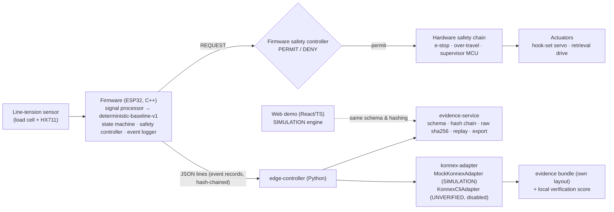

# HookPilot architecture

HookPilot is a prototype for **bite detection, controlled hook-setting and assisted retrieval** on a
fishing rod, with an **auditable evidence trail** designed to fit Konnex Proof-of-Physical-Work (PoPW)
style verification. Today it is software + simulation only; hardware is a design proposal.

## 1. System view

## 2. Components and where they live

| Path | Language | Role | Status |
|---|---|---|---|
| `firmware/` | C++17 | control core: processor, classifier, state machine, safety, logger; host sim (`make sim`) | in progress by firmware team; host sim produces records |
| `apps/web-demo/` | React/TS | interactive SIMULATION demo; own state machine, shared generator + classifier rules (TS ports) | in progress by web team |
| `packages/event-schema/` | JSON Schema | shared event record 1.0.0, examples, standalone validator | done |
| `services/evidence-service/` | Python | canonical hashing, schema validation, chain, raw sha256, replay, CSV export, reference engine, metrics | done |
| `services/konnex-adapter/` | Python | proposed task `detect_bite_and_execute_hook_set`, mock job store, bundle builder, local verifier, CLI skeleton | done (mock) / skeleton (real) |
| `services/edge-controller/` | Python | bridge: firmware stdout → store + mock adapter | done |
| `tests/` | pytest | unit / integration / simulation; reports in `tests/reports/` | 125 pass, 1 opt-in skip |
| `tools/gen_report.py` | Python | regenerates the SIMULATION metrics report from runs | done |
| `hardware/` | docs/CSV/SVG | block diagram, mechanical spec, BOM (ESTIMATES), wiring (PROVISIONAL) | proposal |

## 3. Control flow (contract state machine)

`IDLE → MONITOR → CANDIDATE → CONFIRM → HOOK_SET → RETRIEVE → VERIFY → MONITOR`; any state →
`SAFE_STOP` on a critical fault; `SAFE_STOP` exits only by explicit reset with faults cleared, into
`IDLE` (disarmed). The classifier only *requests* actuation; the safety controller decides; hook-set
and retrieval are never active together (the Python engine enforces a dead time between them and the
verifier checks it in every record).

## 4. Classifier: deterministic-baseline-v1

Rule-based, explainable, every decision carries `result`, `reason` and `rule_trace`. Features: EMA
baseline (frozen during a candidate), delta, smoothed rate, above-trigger duration (total and
continuous), short-term variance, Schmitt-trigger oscillation count of the detrended signal, sensor
health. Rules (firmware order): R0 sensor health → R1 manual-handling delta → R2 max duration → R3
oscillation (vibration) → R4 rate (drift/current) → R5 continuous duration (transient) → confirmed.

**All thresholds are provisional placeholders**, recorded in every event (`classification.thresholds`).

One rule set exists, with the firmware defaults. Firmware C++ is the ground truth. The Python service
(`evidence_service/classifier.py`) and the web demo (`apps/web-demo/src/engine/{processor,detector}.ts`)
are line-by-line ports of it. The former web-demo variant (12 N manual handling, 300 ms window, alpha 0.02)
was retired on 2026-10-18. The Python port reproduces the firmware's results and rule-trace text on all
32 firmware sim records checked. The TS port matches Python's result, reason, rule trace and features on
every committed fixture (tests/integration/test_cross_impl.py, apps/web-demo/tests/cross_impl.test.ts).

## 5. Evidence model

One event record per candidate/cycle (schema 1.0.0): device identity, source (mode, scenario, seed,
ground truth), timestamps + clock quality, calibration version, samples or raw-file ref + sha256,
features, classification, safety decision/interlocks/faults, actuation requests + feedback, outcome
milestones (`fish_landed` never inferred), integrity (record sha256, prev hash, signature = null).

Verification layers:
1. schema validity, 2. record hash, 3. chain linkage, 4. raw-file sha256, 5. deterministic replay
(regenerate the signal from scenario+seed for SIMULATION; re-run the classifier with the recorded
thresholds; rule consistency from recorded features), 6. safety-constraint checks on actuation
telemetry, 7. task-level checks (required fields, allowed thresholds, device identity, labels).

What this does **not** establish: that the physical event happened. See `konnex-integration.md` §6.

## 6. Data flow in a session (target)

1. Firmware samples at 50 Hz, emits event records as JSON lines over serial.
2. `python -m edge_controller --store … --mock-konnex …` validates, verifies hash/chain, stores verbatim,
   forwards to the mock adapter (rejected records are kept in `*.rejected.jsonl`, never dropped).
3. After the session the adapter builds a bundle (manifest + events + raw + task), "proves" it locally
   and scores it against explicit criteria.
4. A reviewer re-runs `python -m evidence_service verify events.jsonl --replay` and
   `python -m konnex_adapter verify-bundle powp.zip` independently.

## 7. Known integration gaps (2026-10-18)
- Classifier and generator are unified (2026-10-18). Remaining difference: the framing lines of the rule trace.
  Python and web start with a `t=… TRIGGER …` line. Firmware appends safety-interruption lines and has its own
  wording for a sensor fault while monitoring. Rule lines R0–R5 are identical.
- Firmware records now include `continuous_above_ms`, as Python and web records do. Older firmware records
  without it are still checked: R5 rule consistency falls back to `duration_above_ms`, as the replay notes say.
- The firmware rig adds actuator line load to the simulated sensor after actuation starts; replay
  therefore compares only pre-actuation samples (documented in replay notes).
- No pin map in firmware yet; `hardware/wiring/` proposes one.
- Firmware hands over from hook-set (at_target) to retrieval on the same 20 ms tick with zero dead time
  and keeps the hook-set servo holding position during retrieval; the verifier accepts a same-tick
  hand-over (no positive-length overlap). The Python engine uses a 40 ms gap. Agree on a minimum dead time.
- The drag-preserving "assist pause" (`assist_pause_n`) exists only in the Python engine; firmware relies
  on the 8 N OVER_TENSION trip. It is therefore optional in the task constraints.
