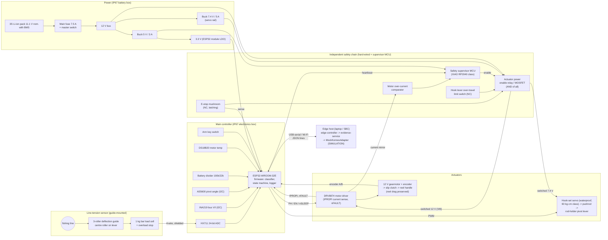

# HookPilot hardware block diagram (PROVISIONAL – nothing below has been built)

Rendered version: [`block-diagram.svg`](block-diagram.svg) (hand-drawn SVG, same content).

## Design rules expressed by the diagram

1. **Actuator power is gated outside the ESP32.** The servo rail and motor-driver VM pass through an
   enable element that is the logical AND of: e-stop (NC, latching), hook-lever over-travel switch (NC)
   and the safety supervisor's enable output. Firmware can *request* actuation; it cannot energise an
   actuator whose power rail the safety chain has cut.
2. **Safety supervisor is a separate MCU** with its own clock and power branch. It drops the enable
   when the ESP32 heartbeat stops (comm-loss / watchdog), when the analogue over-current comparator
   trips, or when its own e-stop sense input opens. After any trip it requires a manual reset
   (button on the box) and boots disarmed — mirroring the contract (`SAFE_STOP -> explicit reset -> IDLE disarmed`).
3. **Sensing path is passive and independent of actuation**: load cell → HX711 → ESP32. The
   classifier never has a direct path to actuators; all requests pass the firmware safety controller
   and then the hardware chain.
4. **Retrieval drives the reel handle, never the spool**, so the reel's drag remains the force limiter
   for fish-side loads; a slip clutch and the driver's current regulation are additional limits.
5. **The host is outside the safety loop.** Loss of the host link is a fault (COMM_LOSS) but nothing
   safety-relevant depends on the host being present.

All part numbers are candidates; see `../bom/bom.csv` (prices are ESTIMATES) and
`../wiring/wiring-table.md` (PROVISIONAL pin map).
